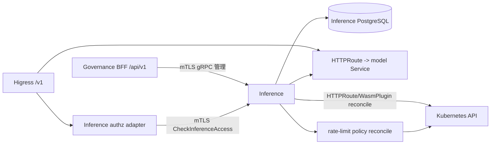

# AI 网关鉴权与限流设计

状态：P1 内部 AK 合同已冻结；网关 adapter 与租户/模型全局限流仍分阶段实施
日期：2026-10-22
范围：`ani-inference-service`、Higress 数据面、Governance BFF 管理入口

## 1. 目标和边界

本设计把 Higress 从运行时控制面中移除，同时为推理数据面提供由
Inference 签发的 AI API key（以下简称 inference key）和可审计的限流策略。

入口边界必须保持不变：

| 入口 | 用途 | 负责方 |
|---|---|---|
| `/api/v1/...` | 模型、模型版本、导入任务和推理服务管理 | Governance BFF；不得经过 Higress AI 路由 |
| `/v1/...` | OpenAI 兼容的推理调用 | Higress；后端是 Inference 发布的模型服务 |
| Inference gRPC | BFF 的控制面调用、内部鉴权检查和发布协调 | Inference，使用现有 mTLS gRPC 合同 |

Inference key 是**数据面凭据**，只授权推理调用；Governance 的平台 API key
仍然是控制面凭据。两者不能共用表、共用前缀或在任一层互相当作已认证身份。
这样可以把签发能力放进 Inference，同时避免复制 Governance 的平台身份账本。

本设计不把 Console UI、Console REST API 或 Console 用户密码作为运行时依赖，
也不把 `/api/v1` 路由到 Higress。Higress 的插件和路由由 Kubernetes API
（HTTPRoute/WasmPlugin）以及 Inference 的持久重协调负责。

## 2. 当前实现和问题

改造前的 `buildKubernetesServers` 要求 `ANI_HIGRESS_CONSOLE_URL`、用户名和密码，
并创建 `HigressConsoleClient`；`HTTPRoutePublisher` 在 Console 非空时调用
native route/service-source API。即使已有 Gateway API 实现，进程启动仍会因为
缺少 Console 配置失败。改造前的 Helm Deployment 也把 Console 凭据注入 Pod；P0
已移除这些运行时读取和 native route 分支。

当前 `ani-request-rate-limit` WasmPlugin 可以由 Inference 通过 Kubernetes API
按 `x-higress-llm-model` 写入 10 QPS 的模型键，并使用 optimistic lock 和
owner annotation 做并发更新。这解决了模型级保护，但不能单独完成：

- inference key 的校验、撤销和过期；
- 按 key 或租户的服务授权；
- RPM/小时配额；
- 跨网关副本的全局计数。

`docs/deploy/higress/key-auth.yaml.tmpl` 目前以静态 `consumers` 保存凭据。
把每个新签发的 secret 继续写入 WasmPlugin 会让长寿命明文凭据进入 Kubernetes
对象和备份，不能作为多租户方案。

## 3. 目标架构



### 3.1 去掉 Console 运行依赖

第一阶段把发布适配器固定到 Gateway API 路径：

1. Inference 创建一个受本服务管理的 `/v1/` bootstrap `HTTPRoute`，指向
   `ani-inference-model-router-sink`；模型发布再创建带有稳定 owner label 的
   模型 `HTTPRoute`，backend 指向 KServe predictor 或 Deployment Service。
2. `HTTPRoutePublisher` 的 `Console` 字段和 native route/service-source 分支
   移除（迁移期可保留类型但必须默认为 nil），启动时不再读取 Console URL、用户名、
   密码，也不再调用 `EnsureBootstrapRoute` 的 Console 分支。
3. Helm 删除 Console 环境变量和凭据 Secret 依赖，ServiceAccount Role 增加
   `gateway.networking.k8s.io/httproutes` 的 get/list/watch/create/patch/delete
   权限，并只允许操作已配置的 route namespace、gateway name 和本服务 owner。
4. 切换前清理历史 native `ani-pub-*` route、`ani-source-*` service source 和
   旧 bootstrap；禁止 native 路由与 HTTPRoute 同时接管同一个 `/v1/` 请求。

Console Pod 是否从 Higress 安装中删除是独立的部署变更。先完成运行时解耦和
真实链路验证，再移除 Console，避免把残留的 native route 误判为业务路由故障。

### 3.2 Inference-owned inference key

Inference 新增数据面 key 模块。本次迁移先只提供 Inference 内部 mTLS gRPC
管理和校验服务，不修改 Governance BFF；后续 BFF 若增加 `/api/v1/inference-keys`
必须另行冻结跨仓合同。管理调用仍由 Inference 的可信租户上下文和操作者身份授权：

- `CreateInferenceAccessKey`：创建名称、服务/模型范围、限流策略、过期时间，返回
  `key_id`、可展示的 `key_prefix` 和一次性 `secret`；
- `ListInferenceAccessKeys` / `GetInferenceAccessKey`：只返回元数据、状态、最后使用时间和
  前缀，永不返回 secret；
- `RevokeInferenceAccessKey`：立即阻止新请求；
- `RotateInferenceAccessKey`：原子地撤销旧 secret 并只返回一次新 secret；
- `CheckInferenceAccess`：仅供网关适配器通过 mTLS 调用，输入 key、service/model
  作用域和请求成本；租户由 key 记录解析，返回允许/拒绝、主体和限流决策。

管理方法放在单独的 `inference.v1.InferenceAccessKeyService` 中，不把 secret
作为现有 `ServicePolicy` 的字段。Inference gRPC 不作为公共匿名 HTTP 管理入口。
本次 API 已通过独立 API 模块提交 `1f0ae265510f` 发布，根模块固定其伪版本，禁止
使用本地 `replace` 绕过模块合同。

### 3.3 存储和 secret 生命周期

实际新增 `inference_access_keys` 表，并配套审计事件和限流桶表：

| 字段 | 约束和用途 |
|---|---|
| `id`, `tenant_id` | 稳定 ID；所有唯一键和查询都带租户 |
| `name`, `key_prefix` | 租户内展示名；前缀用于识别，不能用于认证 |
| `secret_hash`, `hash_version` | 只保存 Argon2id（或同等成本的 KDF）结果；禁止保存明文/可逆密文 |
| `scope` | 允许的 inference service、served model、动作；默认最小权限 |
| `rate_policy` | 每 key 的 QPS、RPM、小时额度和突发值；以结构化列或受约束 JSON 存储 |
| `expires_at`, `revoked_at` | 过期和撤销是拒绝条件，不能只靠缓存失效 |
| `created_by`, `created_at`, `last_used_at` | 审计和运维观察 |
| `idempotency_key`, `version` | 创建/轮换幂等和并发更新 |

secret 生成使用系统 CSPRNG；响应只在创建/轮换成功时返回一次。日志、事件、
错误、数据库快照、Kubernetes 对象和指标中均不得出现 secret；若必须排障，使用
key ID 或前缀。撤销、轮换和删除操作必须写租户范围内审计事件。

Inference key 和 Governance 平台 key 使用不同前缀和验证端点。迁移既有
Governance key 时只迁移经过授权的元数据或由用户重新签发，禁止复制 secret 哈希
或建立双写真相。

## 4. 数据面鉴权和路由流程

单次 `/v1/...` 请求的目标流程是：

1. Higress 仅匹配 `/v1/`，不为 `/api/v1/` 建路由；TLS、请求体大小和基础方法
   校验在网关完成。
2. AUTHN 阶段的独立 authz adapter 从 `x-api-key` 读取 key，将原始值只在内存中
   使用，并以 mTLS 身份 `ani-inference-gateway.ani.internal` 调用
   `CheckInferenceAccess`。
3. Inference 校验前缀、哈希、撤销/过期、租户和服务/模型 scope，执行 key 级限流
   预检查，返回短期可缓存的决定。适配器把可信的 `tenant_id`、
   `inference_key_id` 和 served model 传给后续插件；客户端提供的同名 header 必须
   被覆盖或拒绝，不能直接信任。
4. model-router 根据请求 JSON 解析模型并写入 `x-higress-llm-model`。路由只把
   允许的 `/v1/` 请求送到对应的模型 Service；没有已发布 route 返回 404/403，不能
   回退到任意后端。
5. 请求完成后记录 key/model/tenant 的计数和审计指标。错误语义固定为：缺 key/无效
   key 返回 401，scope 或租户不允许返回 403，超过限额返回 429；不得把鉴权失败
   伪装成后端 404。

P2 可评估 Higress 内置
[`hmac-auth`](https://higress.io/docs/latest/user/plugins/authentication/hmac-auth/)，
它可能承担其他静态网关保护，避免立即维护一套同功能的自定义 Wasm。需要先确认它的当前 OCI 镜像/tag、配置字段、
凭据更新方式以及是否能表达 inference key 的 scope、撤销和过期；在确认前，不能
把静态 consumers 当作动态 key 方案，也不能宣称当前集群已经具备此能力。若内置
插件只能校验静态凭据，Inference 仍需通过适配器或受控 reconcile 提供动态生命周期。

适配器可以是 Higress 自定义 WasmPlugin 或 Envoy ext_authz 服务，具体实现另立
切片。内置 key-auth 的静态 consumer 仅用于迁移期 bootstrap。适配器与 Inference
之间必须使用 mTLS、超时、断路和 fail-close；适配器不可达时不能放行未知 key。

## 5. 限流层次和策略

限流不是单一插件参数，而是从便宜到精确的分层决策：

| 层级 | 键 | 目的 | 执行位置 |
|---|---|---|---|
| 网关基础保护 | listener/route、IP（可选） | 防止异常连接和请求体洪泛 | Higress/Envoy 本地 |
| key 级 | `tenant_id + inference_key_id` | 用户购买/签发的调用额度，支持 QPS、RPM、小时 | Inference PostgreSQL 原子 bucket（P1）；后续可迁移共享限流服务 |
| 租户级 | `tenant_id + served_model` | 防止同租户多 key 绕过总额度 | authz adapter/共享限流服务 |
| 模型级 | `x-higress-llm-model` | 后端容量保护和模型级默认 QPS | 现有 `ani-request-rate-limit` WasmPlugin |
| 后端级 | Service/Deployment | 保护单个推理副本，处理并发和排队 | 模型运行时/服务网格 |

策略可以按资源覆盖，而不把数值写死在插件清单中：

```yaml
key:
  qps: 20
  requests_per_minute: 1000
tenant:
  qps: 100
  requests_per_hour: 20000
model:
  qps: 10
```

上面只是配置格式示例。key、tenant 和 model 的实际值由管理 API 写入
Inference；没有配置的维度使用平台默认策略或不启用该维度。每个维度独立计数，
不会用一个 key 的配置覆盖租户总额度。

这些限额是租户和 key 的可配置策略，不是固定常量。例如某个 key 可以配置
`qps=20`，其所属租户可以配置 `qps=100`，某个模型可以配置 `qps=10`；这些数字
只表示配置形态，不是平台默认规则。一次请求同时检查所有适用的 key、租户和模型
桶，任意一个桶耗尽就返回 429。Inference 保存策略版本，更新策略时通过
reconciler 投影到授权/限流执行层；不能只写入 WasmPlugin 就报告“已生效”。

`ServicePolicy.rate_limits` 的 RPM/小时语义应成为 key/租户策略的一部分，但需要
补齐持久化和执行链路。模型安全上限仍按 owner 和 resourceVersion 重试写入
`WasmPlugin`；更新必须幂等，删除最后一个模型时不写入 Higress 拒绝的空
`limit_keys`；观察到冲突或插件不存在时标记 publication/policy 为 stale。

P1 只执行 key 级 QPS/RPM/小时原子 bucket；租户聚合桶和模型策略管理仍属于 P2。
全局 key/租户限流优先评估 Higress 内置
[`cluster-key-rate-limit`](https://higress.io/en/docs/latest/user/plugins/traffic/cluster-key-rate-limit/)，
并以 Redis 作为共享计数器。接线前必须在目标集群确认插件 OCI 镜像/tag、实际配置 schema、
Redis 地址/认证/TLS、键命名和失败策略；同时验证 Redis 不可用时是 fail-close
还是明确降级。当前仓库和验证集群的已有 `ani-request-rate-limit` 只提供模型键
保护，不能据此推断 `cluster-key-rate-limit` 或 Redis 已安装、可用或已验收。

opaque `x-api-key` 是本次冻结的公开合同，不引入 HMAC 双模式。若内置 cluster
limiter 无法提供所需维度和语义，再采用共享
限流服务作为后备；后备方案必须保持相同的 401/403/429 合同，不得通过把 secret
复制到 WasmPlugin consumers 来绕过缺失能力。

key/租户级计数需要跨 Higress 副本共享或使用带明确一致性语义的限流服务。单个
WasmPlugin 的本地内存计数只能作为近似的模型保护，不能宣称全局 RPM/小时配额。
预检查和扣减应有请求 ID/成本，重试不重复扣减；流式请求的额度结算规则在 API
冻结前明确（建议按接受请求和实际 token 使用分别记录）。

## 6. 重协调和对象所有权

Inference PostgreSQL 是 key、policy、publication 和 operation 的业务权威。
Kubernetes 对象是可重建的执行投影：

- `HTTPRoute` 只由 Inference 创建/更新/删除自己带有 owner、tenant 和 generation
  labels 的对象；共享 Gateway/listener 不得由本服务覆盖；
- `WasmPlugin` 只允许 patch 明确的 rate-limit 插件字段。插件镜像、phase、
  failStrategy 和非本服务配置字段由平台清单管理；reconciler 使用 optimistic
  lock，不整对象覆盖；
- 观察到 UID、field manager 或 owner 不匹配时标记冲突，不自动收养、删除或覆盖；
- 启动先等待 cache sync，再扫描未完成 publication/policy work，Kubernetes watch
  只是加速信号，数据库 due-scan 负责重启和丢事件恢复；
- 路由发布确认、撤销确认和限流插件生效分别记录 generation，Pod Ready 不能代替
  数据面健康或鉴权生效。

迁移期间禁止新旧 Console/native API 和 Gateway API 同时写同一发布。旧对象清理
必须按已记录 UID/owner 执行，并在切换后分别验证 `/v1` 和 `/api/v1` 两条入口。

## 7. 安全风险和缓解

| 风险 | 缓解 |
|---|---|
| secret 泄露到 CRD、日志或备份 | 只存 KDF hash；一次性返回；静态 key-auth 仅迁移期使用 |
| 客户端伪造 tenant/model header | 网关覆盖可信 header；Inference 重新按 key scope 判定 |
| 撤销后缓存继续放行 | 决定缓存短 TTL；撤销版本/epoch；关键操作直查或主动失效 |
| authz adapter 故障导致绕过 | mTLS、超时、fail-close、有限重试；未知状态返回 503/401，不放行 |
| 多 key 绕过租户额度 | 同时扣减 key 和 tenant bucket；租户策略在 Inference 统一计算 |
| 本地插件计数被多副本放大 | 明确本地模型保护只是安全上限；全局额度使用共享计数器 |
| Console/native 残留造成错误路由 | 切换前清单化删除并查询对象；先确认 HTTPRoute 生效再移除 Console |
| 跨租户读写或错误信息泄露 | 复合 tenant 条件、BFF 权限、不可见资源使用统一错误语义和审计 |
| key 管理接口被当作数据面 | `/api/v1` 仅走 Governance BFF，管理 gRPC 只接受受信 mTLS caller |

## 8. 分阶段落地和真实验证

### P0：先完成 Console 解耦

1. 移除运行时 Console 配置和 native 分支，补齐 HTTPRoute/RBAC/owner reconcile。
2. 在验证环境清理旧 native route/source，部署静态 `/v1/` bootstrap 和模型
   HTTPRoute。
3. 验证 `/api/v1` 由 Governance BFF 返回预期鉴权/业务响应；验证 `/v1` 经
   Higress 到真实 predictor，检查 HTTPRoute parent conditions、后端 Service、
   `x-higress-llm-model` 和模型响应。任一 404/503/未发布路由均不算通过。
4. 连续删除/重建 publication，验证 route、rate-limit owner 和 backend 不残留，
   Inference 重启后仍能恢复。

### P1：Inference key 内部服务（已实现基础合同）

1. 已加迁移、sqlc、独立 `InferenceAccessKeyService`、Argon2id hash、一次性
   secret、撤销/轮换和 key 级原子 bucket；secret 不进入 CRD、Helm 或日志。
2. 管理 RPC 仅允许 Governance mTLS 身份；`CheckInferenceAccess` 仅允许
   `ani-inference-gateway.ani.internal`，且该调用不得携带租户/操作者 metadata。
3. authz adapter 尚未接入 Higress，接入时必须验证有效、无效/过期/撤销 key、
   跨租户 scope、伪造 header、超时和 fail-close，并映射 401/403/429。使用测试 key，
   不把 secret 写入仓库或 Helm values。

### P2：策略和全局限流

1. 把 service policy 的 key/tenant/model 规则版本化，reconciler 将模型安全上限
   写入 `ani-request-rate-limit`，并确认对象 resourceVersion 和生效状态。
2. 先确认目标集群已安装并允许使用 `cluster-key-rate-limit`，补齐 Redis、认证、
   TLS 和容量验证；然后验证多网关副本下 RPM/小时、突发、重试和撤销后的计数一致性。
   若前置条件不满足，停在模型级保护，不得声称全局 key/租户限流已生效。
3. 通过故障演练确认数据库、Kubernetes API、authz adapter、Redis/共享限流服务故障时
   的 fail-close、恢复、告警和审计。

每一阶段都分别验证 `/v1/...` 和 `/api/v1/...`；不能用一个入口的 401/404 代替
另一个入口的验收。P1 的 Inference-owned key 管理和校验合同已冻结，但在 authz
adapter 接入并完成真实链路验证前，不能对外宣称 Higress 已支持动态 key。

## 9. 后续未冻结的实现决策

- authz adapter 采用 Higress WasmPlugin 还是 Envoy ext_authz；两者都必须支持
  mTLS、fail-close 和可信 header 注入。公开请求合同固定为 opaque `x-api-key`，不
  再引入 HMAC 双模式。
- `cluster-key-rate-limit` 的目标 OCI 镜像/tag、Redis 部署/认证/TLS、失败策略和
  集群容量；在这些事实确认前不能视作已支持。
- 租户/模型全局限流的存储和执行方式、默认 TTL、轮换宽限期，以及 RPM/小时与
  token 成本的扣减时点、流式请求和失败请求的计费规则。
- 全局计数器的部署形态及其可用性目标。
- Governance BFF 的 API 版本、操作者权限和 key 管理审计事件名称。

当前 P1 已生成 Proto 和迁移；后续决策未冻结前，不应把静态 `consumers` 或仅
模型级 WasmPlugin 当作完整的动态 AK 方案。
