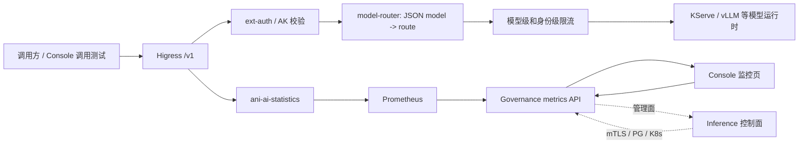

# 推理业务指标接入需求

状态：需求已记录，业务指标接入尚未完成

日期：2026-10-22

## 目标

在推理服务详情页的监控接口中展示真实的模型调用指标。指标必须来自实际的
OpenAI 兼容推理请求，不能使用模拟值，也不能把控制面 gRPC 请求误当成模型调用。

## 指标范围

每个已发布的推理服务，在指定时间范围和采样粒度下提供：

- 请求总数、成功数、失败数、每秒请求量（RPS）；
- 成功率和按错误类别统计的失败数；
- 请求耗时 P50、P95、P99 和最大值；
- 流式请求首 token 延迟（TTFT）和完整响应耗时；
- 输入 token 数、输出 token 数和总 token 数；
- 被限流请求数，以及鉴权失败、模型未找到、上游错误等错误数。

后续可按实际运行时能力增加排队耗时、并发请求数和生成吞吐量，但不能改变上述
基础指标的语义。

## 当前实现和缺口

- Higress 已部署 `ani-ai-statistics` 插件。历史 CPU 推理验收已经观察到模型、token、
  总耗时和流式首 token 数据，说明网关侧具备产生这类数据的能力。
- Higress 的 `/v1/...` 是实际推理入口；`/api/v1/...` 管理接口仍然只走 Governance。
- Governance 的推理 metrics 接口当前已接入 Prometheus，但读取的是按 Pod UID 过滤的
  CPU 和内存序列。
- `ani-inference-service` 的通用 OpenTelemetry/Kratos server 指标主要描述控制面
  gRPC RPC，不足以代表 Higress 转发的模型调用。
- 旧的请求量/延迟 PromQL 查询已经存在，但必须先确认 Prometheus 中有真实产生、可按
  推理服务归属的序列，不能依赖模拟数据回退。

## 待接入的统一业务指标

Higress AI 统计和必要的模型运行时指标需要接入 Governance，形成统一的服务级查询，
再由 Console 监控页展示：

- 请求总数、成功数、失败数；
- RPS；
- P50、P95、P99 延迟；
- 流式首 token 延迟（TTFT）和完整响应耗时；
- 输入 token、输出 token 和总 token；
- 401、403、429、404、上游 5xx 等错误分类。

这部分是待实现需求，不代表当前 Governance metrics 接口已经提供这些字段。

## 待冻结的统计口径

实现前必须明确并写入接口契约和查询测试：

- `429` 是否计入模型请求总数，还是只计入单独的限流计数；
- 流式连接中途断开计为失败、未完成，还是单独的 aborted 类别；
- 完整响应耗时从网关收到请求开始，还是从模型运行时开始生成开始；
- TTFT 从网关收到请求开始，还是从模型运行时收到请求开始；
- token 数以 Higress AI 统计为准，还是以模型运行时响应中的 `usage` 为准；
- 401、403、404、429 和上游 5xx 是否包含在统一失败数中，以及各类之间是否互斥；
- 重试请求按每次网关尝试计数，还是按一次外部逻辑请求计数。

在这些口径冻结前，不能把不同层产生的数字直接相加，也不能用网关指标和模型运行时
指标互相替代。

## 真实数据链路要求

实际请求指标的首选来源是 Higress `ani-ai-statistics` 产生并被 Prometheus 抓取的
数据；如果某项指标只能由模型运行时提供（例如精确 token 计数），则接入运行时的
Prometheus 指标，并在 Governance 层统一输出格式。

指标归属必须使用受 Inference 管理的可信路由或服务映射。不能信任客户端自带的
`service_id`、租户 header 或模型路由 header，也不能把原始 API key、request ID 或
高基数租户标识直接作为长期指标标签。授权身份仍由 ext-auth/Inference 决定。

## 验收标准

1. 通过 Higress `/v1/completions` 和 `/v1/chat/completions` 发起成功、失败、流式和
   被限流请求后，Prometheus 中能查到对应业务序列。
2. 同一个服务的请求不会混入其他服务或旧 Pod；服务路由切换后历史数据归属不变。
3. Governance metrics API 能按服务、时间范围和 step 返回请求量、成功率、延迟、token
   和限流/错误指标，缺少数据时返回明确的 unavailable/empty 语义，不返回模拟值。
4. Console 监控页展示的数值与 Prometheus 查询结果一致，流式请求同时展示 TTFT 和完整
   响应耗时。
5. 分别验证 Higress `/v1/...` 推理入口和 Governance `/api/v1/...` 管理入口；管理
   API 不得被 Higress 路由接管。

## 实施顺序

1. 盘点 `ani-ai-statistics` 实际暴露的 metric 名称、标签、抓取目标和保留周期，并用
   一次真实请求核对计数、延迟、token 和 TTFT。
2. 固定 route-name/service-id 的可信映射和低基数标签规则，补齐失败、限流、流式语义。
3. 在 Governance metrics reader 中增加业务 PromQL 查询和响应字段，移除业务指标的
   模拟回退。
4. 更新 Console 监控展示、时间范围/采样粒度和空数据提示。
5. 完成真实网关请求、Prometheus 查询、Governance 接口和 Console 页面联合验收。

## 候选后续：Higress 插件管理页面

当前插件通过 Helm、Kubernetes 清单和受控运维步骤安装，ANI Console 没有插件目录、
插件状态或安装操作页面。后续可以增加一个面向平台管理员的插件管理能力，至少包括：

- 查看已安装插件的名称、版本或 digest、phase、匹配路径、启停状态和健康状态；
- 查看插件配置、依赖和影响的网关入口；
- 在受控插件仓库中选择插件，执行安装、启用、停用、升级和回滚；
- 展示安装结果、配置校验错误、镜像拉取错误和网关生效状态。

这项能力应由 Console 调用 Governance 管理 API，再由受控的网关适配器写入
Kubernetes `WasmPlugin`/相关 Gateway 资源。页面不能直接连接 Higress Console，也不能
允许任意 OCI 地址或未审核的插件配置进入集群。插件镜像应固定到允许的内部仓库和
digest，并保留变更审计、权限校验和回滚记录。

该候选需求不改变现有入口边界：Higress 仍只处理 `/v1/...` 推理请求，Governance
仍负责 `/api/v1/...` 管理接口。
